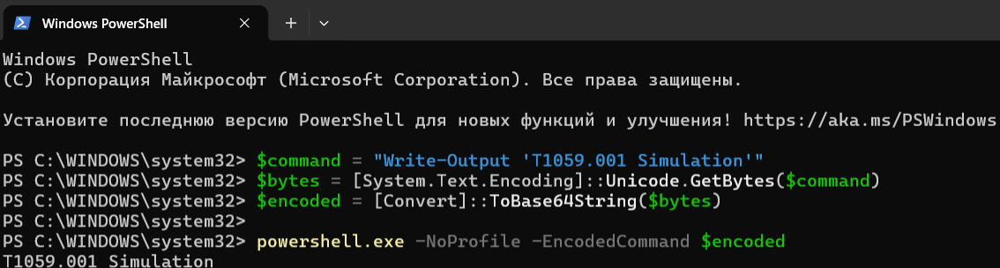
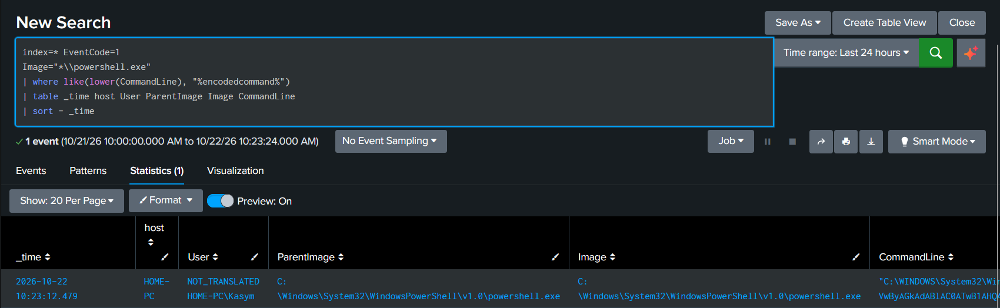

# Week 6 — ATT&CK Technique Study: T1059.001 PowerShell

**Task (syllabus §3.3):** study one specific ATT&CK technique, simulate it and map the results to ATT&CK tactics and techniques.

## Technique Overview

**MITRE ATT&CK Tactic:** Execution (TA0002)  
**Technique:** Command and Scripting Interpreter: PowerShell (T1059.001)  
**Platform:** Windows

### Description
PowerShell is a Windows command-line shell and scripting language used for system administration and automation. Attackers abuse PowerShell to execute malicious commands and scripts, often blending their activities with legitimate administrative operations.

### Why Attackers Use PowerShell
- **Command Execution:** Run malicious scripts and system commands.
- **Defense Evasion:** Obfuscate commands and attempt to bypass security controls.
- **Fileless Attacks:** Execute malicious code directly in memory.
- **System Reconnaissance:** Collect information about users, processes, and system configurations.
- **Payload Delivery:** Download and execute additional malicious components.
- **Lateral Movement:** Execute commands on remote systems using PowerShell Remoting.

**Key Point:** PowerShell is a legitimate administrative tool, so its execution alone does not indicate malicious activity. Analysts must examine command-line arguments, parent processes, and execution context.

**Reference:** [MITRE ATT&CK — T1059.001](https://attack.mitre.org/techniques/T1059/001/)

## Data Sources for Detection

| Source | Event ID | What it records | Key fields for the analyst |
|---|---|---|---|
| Sysmon | **1 — Process Create** | Every process start, with full command line and parent process | `Image`, `CommandLine`, `ParentImage`, `ParentCommandLine`, `User`, `Hashes` |
| PowerShell Operational | **4104 — Script Block Logging** | The text of PowerShell code actually executed, recorded after decoding | `ScriptBlockText`, `ScriptBlockId`, `Path` |

**Sysmon Event ID 1** answers *who started PowerShell, from where, and with which parameters*.
The most valuable field is the parent process: PowerShell started by a user from Explorer
or a terminal is normal, while PowerShell started by an Office application or a script host
needs a closer look. Location: *Microsoft → Windows → Sysmon → Operational*.

**PowerShell Event ID 4104** answers *what the script actually did*. Because PowerShell logs
the script block after decoding, it shows readable code even when the command line itself
was encoded, which makes it the most useful source for investigations.
It is enabled through Group Policy or the registry key
`HKLM\SOFTWARE\Policies\Microsoft\Windows\PowerShell\ScriptBlockLogging`
(`EnableScriptBlockLogging = 1`). Location: *Microsoft → Windows → PowerShell → Operational*.

**Correlation.** The two sources complement each other: Event 1 gives the process context
(parent, user, time), and Event 4104 gives the content. Linking them by host and time,
and adding Sysmon Event 3 (network connections) and Event 22 (DNS queries), shows the full
chain from launch to any network activity.

In this project both sources are collected into Splunk (index `main`) on the Windows 11 lab machine.

## Mitigations

| ATT&CK ID | Mitigation | How it applies to PowerShell |
|---|---|---|
| M1049 | Antivirus / Antimalware | **AMSI** lets Microsoft Defender scan PowerShell code in memory before it runs, including decoded content |
| M1038 | Execution Prevention | **AppLocker / Windows Defender Application Control** restrict which scripts may run; PowerShell then works in **Constrained Language Mode** for untrusted code |
| M1042 | Disable or Remove Feature | Remove the legacy **PowerShell v2** engine, which lacks modern logging and AMSI support |
| M1045 | Code Signing | Execution policy `AllSigned` permits only signed scripts in managed environments |
| M1026 | Privileged Account Management | **Just Enough Administration (JEA)** limits which commands administrators can run remotely |
| — | Logging | Enable Script Block Logging (4104), Module Logging (4103) and Transcription, and forward the logs to a SIEM |
| — | User execution controls | Block Office macros in files from the Internet and restrict opening shortcut / script files from email attachments, which cuts the delivery chain seen in weeks 2 and 4 |

No single control is enough: logging makes activity visible, AMSI and application control
reduce what can run, and blocking risky file types stops the chain before PowerShell starts.

## Simulation and Results

### Simulation

The MITRE ATT&CK T1059.001 (PowerShell) technique was simulated on a Windows endpoint using a Base64-encoded PowerShell command.

The purpose of this simulation was to demonstrate how attackers can use encoded PowerShell commands to execute scripts while making their contents less readable in process command-line logs.

**Simulation Environment:**
- Operating System: Windows
- Hostname: HOME-PC
- Attack Technique: T1059.001 — PowerShell
- Simulation Method: Encoded PowerShell Command
- Monitoring Tools: Sysmon and Splunk Enterprise

**Executed PowerShell Commands:**

```powershell
$command = "Write-Output 'T1059.001 Simulation'"
$bytes = [System.Text.Encoding]::Unicode.GetBytes($command)
$encoded = [Convert]::ToBase64String($bytes)

powershell.exe -NoProfile -EncodedCommand $encoded
```

**Execution Result:**

```text
T1059.001 Simulation
```

The command was successfully encoded using Base64 and executed through a new PowerShell process with the `-EncodedCommand` parameter.

The simulation was performed in a controlled environment without executing malicious payloads.

**Screenshot 1 — PowerShell Simulation**



### Detection in Splunk

After executing the PowerShell command, Splunk Enterprise was used to identify the corresponding Sysmon process creation event.

**Splunk SPL Query:**

```spl
index=* EventCode=1
Image="*\\powershell.exe"
| where like(lower(CommandLine), "%encodedcommand%")
| table _time host User ParentImage Image CommandLine
| sort - _time
```

**Detection Results:**

| Field | Observed Value |
|---|---|
| Event ID | 1 |
| Event Time | 2026-10-22 10:23:12.479 |
| Host | HOME-PC |
| User | HOME-PC\Kasym |
| Image | powershell.exe |
| ParentImage | powershell.exe |
| CommandLine | Contains Base64-encoded PowerShell command |
| Events Detected | 1 |

Splunk successfully identified one Sysmon Event ID 1 associated with the encoded PowerShell execution.

The event contained information about the executed process, parent process, user account, and command-line arguments.

**Screenshot 2 — Splunk Detection**



---

## Event Analysis and MITRE ATT&CK Mapping

### Event Analysis

The collected Sysmon event confirms that a PowerShell process was created with the `-EncodedCommand` parameter.

The following observations were identified:

1. **Process Execution:** `powershell.exe` was executed on the Windows endpoint.
2. **Encoded Command:** The `-EncodedCommand` parameter was used to execute a Base64-encoded command.
3. **Parent Process:** The parent process was another PowerShell instance, indicating that PowerShell launched a child PowerShell process. This is because the command was run from an interactive PowerShell console; in a real phishing scenario the parent would typically be an Office application or a shortcut file, and this parent–child relationship is what the MITRE CAR analytic in week 7 relies on.
4. **Event Logging:** Sysmon recorded the execution as Event ID 1.
5. **SIEM Detection:** Splunk successfully identified the event using an SPL search query.

### MITRE ATT&CK Mapping

| Category | MITRE ATT&CK Mapping |
|---|---|
| Tactic | Execution (TA0002) |
| Technique | Command and Scripting Interpreter (T1059) |
| Sub-technique | PowerShell (T1059.001) |
| Execution Method | Base64-Encoded PowerShell Command |
| Data Source | Sysmon Process Creation |
| Event ID | 1 |

### Security Analysis

Attackers may use encoded PowerShell commands to obfuscate script content and reduce the effectiveness of simple command-line detection mechanisms.

In this simulation, the Base64-encoded command was harmless and only displayed a test message.

However, the same execution method can be used to run malicious scripts.

The results demonstrate that monitoring PowerShell process creation and command-line arguments can help security analysts identify potentially suspicious activity.

### Conclusion

The T1059.001 PowerShell simulation was successfully completed.

Sysmon recorded the encoded PowerShell execution, and Splunk Enterprise detected the corresponding event.

The experiment demonstrates how process creation logs can support the detection and investigation of PowerShell-based attack techniques.

## References

- [MITRE ATT&CK — T1059.001 PowerShell](https://attack.mitre.org/techniques/T1059/001/)
- Microsoft Learn — *about_Logging_Windows*, *PowerShell security features*
