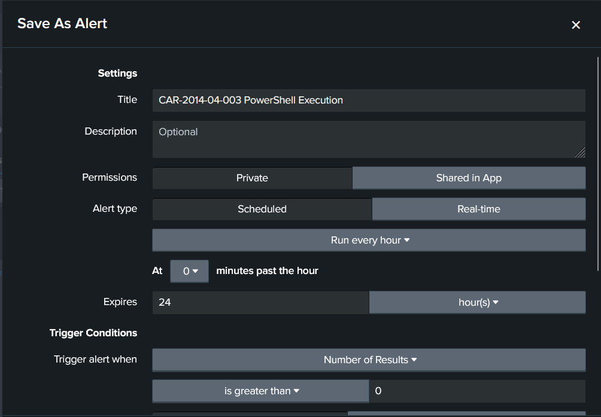
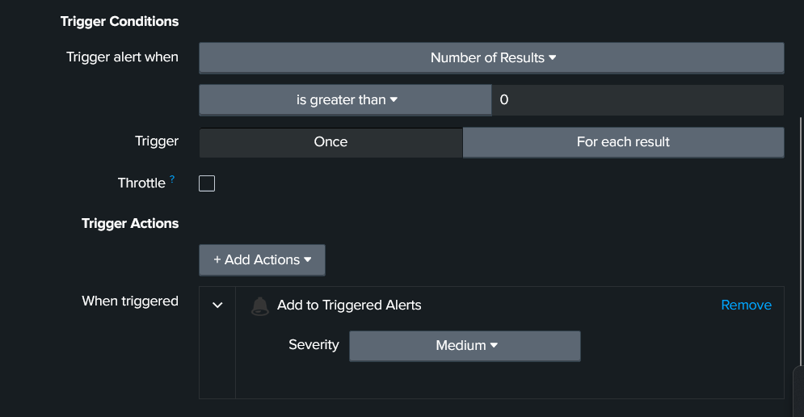
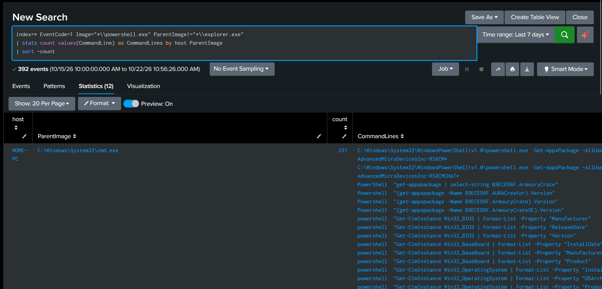
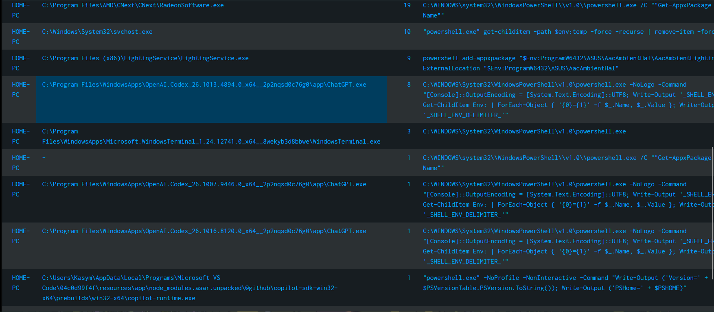

# Week 7 — MITRE CAR Analytic Implemented in a SIEM

**Task (syllabus §3.3):** select an analytic model from the MITRE Cyber Analytics Repository (CAR), implement it in a SIEM and map the analytic to the related ATT&CK techniques.

**Selected analytic:** [CAR-2014-04-003 — PowerShell Execution](https://car.mitre.org/analytics/CAR-2014-04-003/)
**SIEM:** Splunk Enterprise on the Windows 11 lab machine (`HOME-PC`), data from Sysmon and the PowerShell Operational log (set up in week 6).

## 1. Why this analytic

The whole project follows one chain: spear-phishing → the user opens a file → PowerShell runs a payload (weeks 2 and 4). Week 6 studied T1059.001 PowerShell and produced a test event in Splunk. CAR-2014-04-003 is the CAR analytic written for exactly this technique, so it turns the week-6 study into a permanent detection rule.

## 2. The analytic

| Field | Value |
|---|---|
| ID / name | CAR-2014-04-003 — PowerShell Execution |
| Idea | PowerShell started by a user from Windows Explorer is normal. PowerShell started by **any other process** is worth reviewing, because malware, macros and scripts launch PowerShell as a child process |
| Data model | `process` / `create` — fields `exe`, `parent_exe` |
| Data source used | Sysmon Event ID 1 (Process Create) |

**CAR pseudocode:**
```
process = search Process:Create
powershell = filter process where (exe == "powershell.exe" AND parent_exe != "explorer.exe")
output powershell
```

### ATT&CK mapping

| ATT&CK tactic | Technique | CAR coverage |
|---|---|---|
| Execution (TA0002) | **T1059.001** Command and Scripting Interpreter: PowerShell | High |
| Defense Evasion (TA0005) | T1059.001 (PowerShell used to blend in with legitimate administration) | Moderate |

D3FEND counter-measure listed by CAR: **D3-PSA Process Spawn Analysis**.

## 3. Implementation in Splunk

CAR's Splunk implementation was adapted to the lab's field names (Sysmon fields `Image`, `ParentImage`, `CommandLine` are extracted automatically):

```spl
index=* EventCode=1 Image="*\\powershell.exe" ParentImage!="*\\explorer.exe"
| stats count values(CommandLine) as CommandLines by host ParentImage
| sort -count
```

The search was saved as a **scheduled alert**:

| Setting | Value |
|---|---|
| Title | CAR-2014-04-003 PowerShell Execution |
| Schedule | Every hour |
| Trigger | Number of results > 0, trigger once per run |
| Action | Add to Triggered Alerts, severity Medium |
| Permissions | Private (single-analyst lab) |




## 4. Results (last 7 days)

The analytic returned **392 events in 12 parent-process groups** on a single home laptop.




| Parent process | Events | What it was | Verdict |
|---|---|---|---|
| `cmd.exe` | 337 | Vendor utilities querying hardware and installed packages (`Get-AppxPackage AdvancedMicroDevicesInc-…`, `ArmouryCrate`, `Get-CimInstance Win32_BIOS / Win32_BaseBoard / Win32_OperatingSystem`) | Benign — AMD / ASUS software |
| `RadeonSoftware.exe` (AMD) | 19 | `Get-AppxPackage` version checks | Benign |
| `svchost.exe` | 10 | Clean-up of the `%TEMP%` folder | Benign — scheduled maintenance |
| `LightingService.exe` (ASUS) | 9 | `Add-AppxPackage` for the lighting component | Benign |
| `ChatGPT.exe` (3 app versions) | 10 | Reading environment variables for an AI coding assistant | Benign |
| `WindowsTerminal.exe` | 3 | User opening PowerShell in Windows Terminal | Benign — interactive use |
| VS Code `copilot-runtime.exe` | 1 | Checking the PowerShell version | Benign |
| *(empty parent)* | 1 | Parent process already exited before logging | Benign |
| `powershell.exe` | 1 | **Week 6 test: Base64-encoded command (`-EncodedCommand`)** | **Expected detection** |
| one further group | 1 | Single event, not visible in the screenshots | Not reviewed |

The week-6 test event (parent `powershell.exe`, see week 6 report) falls inside the 7-day window and matches the analytic's condition, so it is among the results.

**Interpretation:**

- **True positive.** The week-6 test with an encoded command was caught — the analytic works.
- **False-positive rate is very high.** Almost all hits are legitimate. On modern Windows PowerShell is used by drivers, vendor utilities, terminals and developer tools, so *"PowerShell not started by Explorer"* is far too broad on its own. Even Windows Terminal — the normal way a user opens PowerShell today — is flagged, because the analytic was written in 2014 when Explorer was the usual parent.
- **cmd.exe cannot simply be excluded.** It is the largest source of noise, but attackers also chain `cmd.exe → powershell.exe`, so excluding it entirely would create a blind spot.

## 5. Tuning the analytic

The following versions are proposed based on the results above; they are the next step for the alert.

### Version 2 — reduce noise with known-good parents

Exclude legitimate parents **by full path** (not just by file name, because an attacker can name a file `RadeonSoftware.exe`), and exclude `cmd.exe` only for the known vendor command lines:

```spl
index=* EventCode=1 Image="*\\powershell.exe" ParentImage!="*\\explorer.exe"
  NOT ParentImage IN ("C:\\Program Files\\AMD\\CNext\\CNext\\RadeonSoftware.exe",
                      "C:\\Program Files (x86)\\LightingService\\LightingService.exe",
                      "C:\\Program Files\\WindowsApps\\Microsoft.WindowsTerminal_*\\WindowsTerminal.exe")
  NOT (ParentImage="*\\cmd.exe" AND (CommandLine="*Get-AppxPackage*" OR CommandLine="*Get-CimInstance Win32_*"))
| stats count values(CommandLine) as CommandLines by host ParentImage
| sort -count
```


### Version 3 — high-priority alert for the project's attack chain

Combine the CAR idea with the behaviour seen in weeks 2, 4 and 6: PowerShell started by an Office application or a script host, **or** with an encoded command:

```spl
index=* EventCode=1 Image="*\\powershell.exe" ParentImage!="*\\explorer.exe"
  (ParentImage IN ("*\\WINWORD.EXE","*\\EXCEL.EXE","*\\OUTLOOK.EXE","*\\POWERPNT.EXE",
                   "*\\wscript.exe","*\\cscript.exe","*\\mshta.exe")
   OR CommandLine="*-enc*" OR CommandLine="*EncodedCommand*")
| table _time host User ParentImage CommandLine
```


| Version | Purpose | Expected volume |
|---|---|---|
| 1 — original CAR | Broad visibility, hunting baseline | High (392 events / 7 days) |
| 2 — allowlist | Day-to-day monitoring with known software removed | Medium |
| 3 — chain-specific | Alert that matches the phishing → PowerShell chain | Low, high fidelity |

## 6. Limitations

- Only `powershell.exe` is covered; PowerShell 7 (`pwsh.exe`) and PowerShell hosted inside other programs would need extra conditions.
- An allowlist must be maintained: software updates change paths (e.g. the version number in the ChatGPT and Windows Terminal folders).
- Process-creation data shows *that* PowerShell ran, not *what* the script did; for content, the analytic should be paired with PowerShell Script Block Logging (Event ID 4104) from week 6.
- Results come from one personal laptop; a corporate environment would have a different set of legitimate parents.

## 7. Conclusion

CAR-2014-04-003 was implemented in Splunk as a scheduled alert and mapped to ATT&CK T1059.001 (Execution). It detected the week-6 test, but in its original form 99 % of the results on a normal workstation were legitimate software. The analytic is valuable as a **starting point**: after tuning with a path-based allowlist and the parent / command-line patterns of the project's attack chain, it becomes a practical, low-noise detection for malicious PowerShell execution.

## References

- MITRE CAR — [CAR-2014-04-003: PowerShell Execution](https://car.mitre.org/analytics/CAR-2014-04-003/)
- MITRE ATT&CK — [T1059.001 PowerShell](https://attack.mitre.org/techniques/T1059/001/)
- MITRE D3FEND — D3-PSA Process Spawn Analysis
- C. Maurice, *The Foundations of Threat Hunting*, 2022
