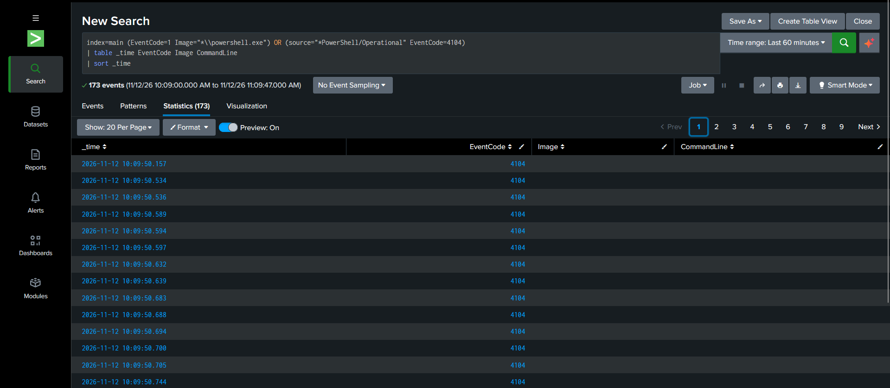
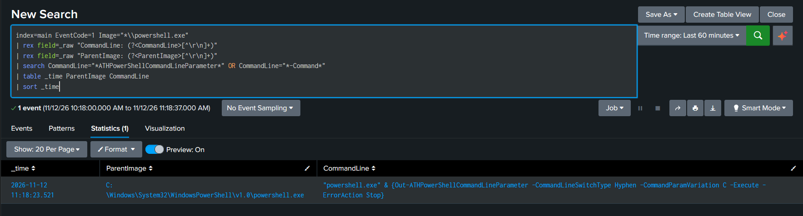
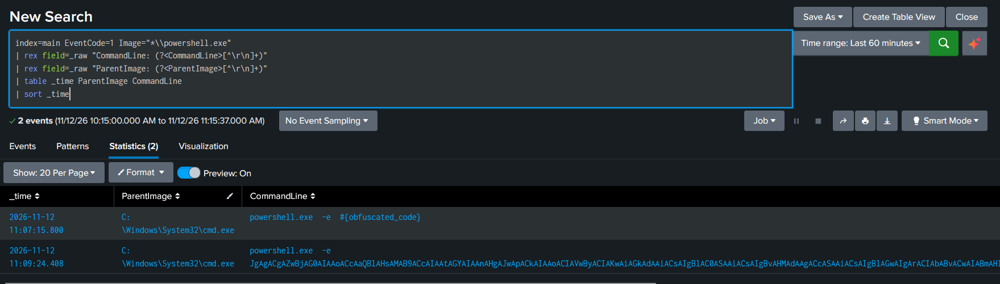
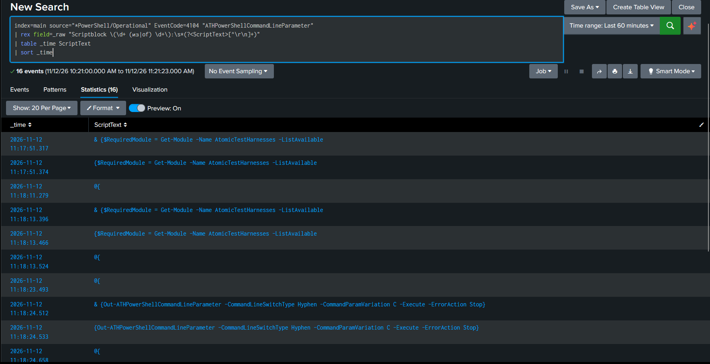

# Week 9 — Atomic Red Team: Test Execution and Detection Coverage

**Task (syllabus §3.3):** run selected atomic tests (e.g. T1059), record and analyse the results in a SIEM, and document detection coverage. Recommended reading: Atomic Red Team wiki and GitHub repository.

## 1. What Atomic Red Team is

[Atomic Red Team](https://github.com/redcanaryco/atomic-red-team) (Red Canary) is an open library of small, focused tests ("atomics"). Each atomic reproduces the behaviour of one ATT&CK technique in a defined, repeatable way, so a defender can check whether their monitoring detects it. It is used here purely to **validate detection**, not to attack a target.

- **Execution framework:** `Invoke-AtomicRedTeam` (PowerShell module)
- **Tests:** the `atomics` folder (`C:\AtomicRedTeam\atomics`)
- **Lab:** the author's own standalone Windows 11 host (`HOME-PC`), with Sysmon and PowerShell Script Block Logging feeding Splunk (`index=main`), as built in weeks 6–8.

## 2. Technique and tests executed

The project's core technique was validated: **T1059.001 — Command and Scripting Interpreter: PowerShell** (tactic: Execution, TA0002).

| Atomic test | Name | What it does | ATT&CK |
|---|---|---|---|
| #13 | ATHPowerShellCommandLineParameter – `-Command` variations | runs `powershell.exe` with variants of the `-Command` parameter | T1059.001 |
| #16 | ATHPowerShellCommandLineParameter – `-EncodedCommand` with encoded arguments | runs `powershell.exe` with a Base64 `-EncodedCommand` | T1059.001 (+ T1027 Obfuscation) |
| #17 | PowerShell Command Execution | runs a plain PowerShell command | T1059.001 |

Tests were launched with `Invoke-AtomicTest T1059.001 -TestNumbers 13,16,17` on the lab host. Tests that use real offensive tooling in this technique (e.g. Mimikatz, BloodHound) were deliberately **not** run — they are credential-theft and AD-reconnaissance tools, out of scope for a detection-validation project.

## 3. Results in the SIEM

After execution, the tests appeared in Splunk. A broad query returned **173 PowerShell events in the last hour**, confirming the pipeline Atomic Red Team → Sysmon / PowerShell logging → Splunk works end to end.



### Test #13 — readable command line (Sysmon Event ID 1)

```spl
index=main EventCode=1 Image="*\\powershell.exe"
| rex field=_raw "CommandLine: (?<CommandLine>[^\r\n]+)"
| rex field=_raw "ParentImage: (?<ParentImage>[^\r\n]+)"
| search CommandLine="*ATHPowerShellCommandLineParameter*"
| table _time ParentImage CommandLine | sort _time
```

The test was detected with its full command line visible:

`powershell.exe & {Out-ATHPowerShellCommandLineParameter -CommandLineSwitchType Hyphen -CommandParamVariation C -Execute -ErrorAction Stop}`



### Test #16 — encoded command: two views of the same action

In **Sysmon Event ID 1** the command line is an unreadable Base64 blob:

`powershell.exe -e JgAgAGcAZwBjAG0AIAAoAC...`



In **PowerShell Event ID 4104** the same execution is recorded with the script text **decoded and readable** (`Out-ATHPowerShellCommandLineParameter …`, plus the dependency check `Get-Module AtomicTestHarnesses`):



This repeats and confirms the central finding of weeks 6 and 8: **Base64 hides a command from the process command line, but not from Script Block Logging.**

## 4. Detection coverage matrix

| ATT&CK technique | Atomic test | Executed | Detected in Sysmon 1 (process) | Detected in 4104 (script text) | Coverage |
|---|---|---|---|---|---|
| T1059.001 PowerShell | #13 `-Command` | ✅ | ✅ readable command line | ✅ | **Full** |
| T1059.001 PowerShell | #16 `-EncodedCommand` | ✅ | ⚠️ visible but Base64-encoded | ✅ decoded | **Full** (needs 4104 to read) |
| T1059.001 PowerShell | #17 command execution | ✅ | ✅ | ✅ | **Full** |
| T1027 Obfuscation (via #16) | — | ✅ | ⚠️ encoded only | ✅ decoded | **Partial** — needs 4104 |

**Reading of the matrix:**

- All three atomic tests for **T1059.001 are fully detected** by the lab pipeline.
- The encoded test (#16) shows **why two data sources are needed**: Sysmon alone sees an unreadable command, and only Script Block Logging (4104) reveals the content. Detection coverage for the *obfuscation* aspect depends on 4104 being enabled.
- This is consistent across weeks 6, 8 and 9 — the same technique, confirmed with manual commands (week 6), a detection test (week 8) and now the official Atomic Red Team tests (week 9).

## 5. Observation — Atomic Red Team's own footprint

During setup the framework itself generated PowerShell activity: it downloaded the `atomics` folder from GitHub (`Invoke-WebRequest`, `curl.exe`, `art.zip`) and, as part of its install, ran `Set-MpPreference -DisableRealtimeMonitoring $true`. The latter maps to **T1562.001 Impair Defenses**. In a real hunt this is an important lesson: a testing tool leaves its own telemetry, and an analyst must separate tool-setup noise from the actual technique under test (done here by filtering on the test name and timestamps).

## 6. Conclusion

Atomic Red Team was installed on the lab host and three T1059.001 tests (#13, #16, #17) were executed and recorded in Splunk. All three were detected; the encoded test confirmed that process logging and Script Block Logging are complementary. The detection-coverage matrix shows **full coverage of T1059.001** — the project's core technique — across three independent methods over weeks 6–9.

## 7. Link to the project

| Week | How it connects |
|---|---|
| 6 | First manual T1059.001 test and its detection |
| 7 | CAR analytic that alerts on these PowerShell executions |
| 8 | Detection-validation test of Execution + Discovery |
| 9 | Official Atomic Red Team tests confirm the same coverage |

## References

- Red Canary — Atomic Red Team: https://github.com/redcanaryco/atomic-red-team
- Invoke-AtomicRedTeam wiki: https://github.com/redcanaryco/invoke-atomicredteam/wiki
- MITRE ATT&CK — T1059.001 PowerShell: https://attack.mitre.org/techniques/T1059/001/
